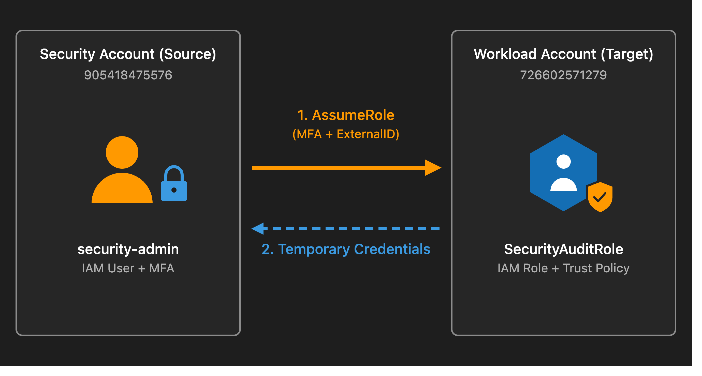
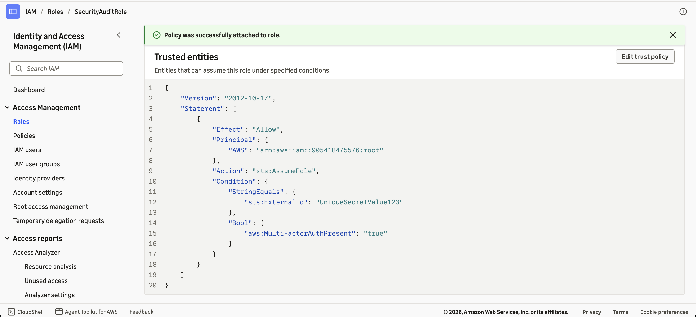
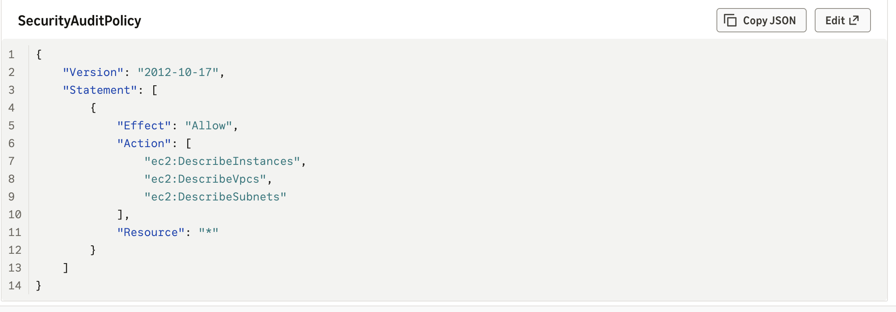
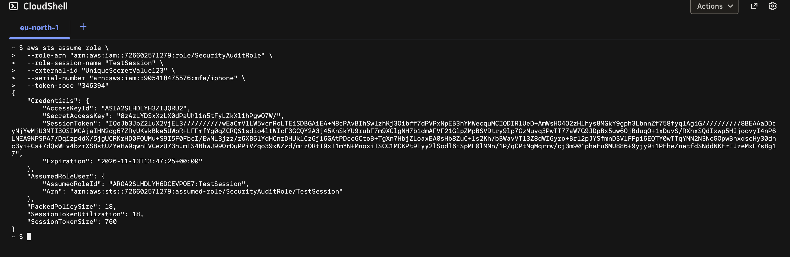
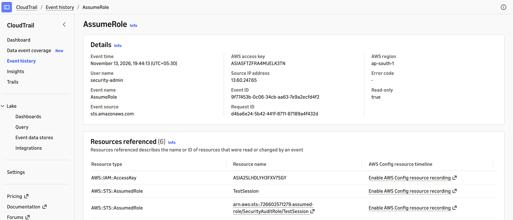

## 1. Project Overview

This project demonstrates the secure implementation of **Cross-Account Access in AWS using IAM Role Assumption**.

Instead of relying on insecure, long-lived IAM credentials, this architecture uses **AWS STS (Security Token Service)** to generate temporary credentials.

The solution enforces strict security controls, including an **External ID** to mitigate the Confused Deputy problem and **MFA enforcement** in the trust policy, adhering to the principle of least privilege.

---

## 2. Architecture Overview

The environment consists of two isolated AWS accounts:

- **Security Account (Source):** `905418475576` — Contains the `security-admin` IAM user.
    
- **Workload Account (Target):** ``726602571279`` — Contains the `SecurityAuditRole`.
    



---

## 3. Implementation Steps

### Step 1: Target Role & Trust Policy (Workload Account)

Created the `SecurityAuditRole` in the Workload Account. The trust policy strictly requires the Security Account ID, a specific External ID (`UniqueSecretValue123`), and MFA validation.

**Trust Policy JSON:**

```
{
  "Version": "2012-10-17",
  "Statement": [
    {
      "Effect": "Allow",
      "Principal": {
        "AWS": "arn:aws:iam::905418475576:root"
      },
      "Action": "sts:AssumeRole",
      "Condition": {
        "StringEquals": {
          "sts:ExternalId": "UniqueSecretValue123"
        },
        "Bool": {
          "aws:MultiFactorAuthPresent": "true"
        }
      }
    }
  ]
}
```



---

### Step 2: Permission Policy (Workload Account)

Created a custom IAM policy, `SecurityAuditPolicy`, following the principle of least privilege.

It only allows read-only EC2 actions and is attached to the `SecurityAuditRole`.

**Permission Policy JSON:**

```
{
  "Version": "2012-10-17",
  "Statement": [
    {
      "Effect": "Allow",
      "Action": [
        "ec2:DescribeInstances",
        "ec2:DescribeVpcs",
        "ec2:DescribeSubnets"
      ],
      "Resource": "*"
    }
  ]
}
```



---

### Step 3: Source Principal Policy (Security Account)

Attached an inline policy to the `security-admin` user in the Security Account.

This allows the user to call `sts:AssumeRole` exclusively on the Workload Account's role.

**Source Account Inline Policy JSON:**

```
{
  "Version": "2012-10-17",
  "Statement": [
    {
      "Effect": "Allow",
      "Action": "sts:AssumeRole",
      "Resource": "arn:aws:iam::726602571279:role/SecurityAuditRole"
    }
  ]
}
```

---

### Step 4: Validation (Role Assumption)

Executed an `assume-role` command via AWS CloudShell in the Security Account, providing the External ID, MFA device ARN, and a live MFA token.

```
aws sts assume-role \
  --role-arn "arn:aws:iam::726602571279:role/SecurityAuditRole" \
  --role-session-name "TestSession" \
  --external-id "UniqueSecretValue123" \
  --serial-number "arn:aws:iam::905418475576:mfa/iphone" \
  --token-code "XXXXXX"
```



---

## 4. Infrastructure as Code (Terraform)

To ensure reproducibility and scalability, the infrastructure is modeled using Terraform.

### `provider.tf`

```
terraform {
  required_providers {
    aws = {
      source  = "hashicorp/aws"
      version = "~> 5.0"
    }
  }
}

provider "aws" {
  region = "ap-south-1"
}
```

### `main.tf`

```
data "aws_iam_policy_document" "trust_policy" {
  statement {
    effect = "Allow"

    principals {
      type        = "AWS"
      identifiers = ["arn:aws:iam::905418475576:root"]
    }

    actions = ["sts:AssumeRole"]

    condition {
      test     = "StringEquals"
      variable = "sts:ExternalId"
      values   = ["UniqueSecretValue123"]
    }

    condition {
      test     = "Bool"
      variable = "aws:MultiFactorAuthPresent"
      values   = ["true"]
    }
  }
}

resource "aws_iam_role" "security_audit_role" {
  name               = "SecurityAuditRole"
  assume_role_policy = data.aws_iam_policy_document.trust_policy.json
}

data "aws_iam_policy_document" "permission_policy" {
  statement {
    effect = "Allow"

    actions = [
      "ec2:DescribeInstances",
      "ec2:DescribeVpcs",
      "ec2:DescribeSubnets"
    ]

    resources = ["*"]
  }
}

resource "aws_iam_policy" "security_audit_policy" {
  name   = "SecurityAuditPolicy"
  policy = data.aws_iam_policy_document.permission_policy.json
}

resource "aws_iam_role_policy_attachment" "attach_audit_policy" {
  role       = aws_iam_role.security_audit_role.name
  policy_arn = aws_iam_policy.security_audit_policy.arn
}
```

---

## 5. Monitoring & Alerting

To detect misuse of this cross-account access, CloudTrail is enabled in the Workload Account.

The `AssumeRole` API calls are logged for auditing. In a production environment, CloudWatch Metric Filters can be configured to trigger SNS alarms for failed `AccessDenied` attempts.



---

## 6. Security Considerations

- **Least Privilege:** The `SecurityAuditRole` only has `Describe*` permissions. If compromised, the blast radius is minimized.
    
- **Confused Deputy Protection:** The `ExternalId` helps ensure that only the authorized principal can assume the role under the expected conditions.
    
- **MFA Enforcement:** The trust policy enforces `aws:MultiFactorAuthPresent`, adding an additional layer of protection against credential misuse.
    

---

## Appendix: `.gitignore`

```
# Terraform State Files
*.tfstate
*.tfstate.backup
*.tfvars
.terraform/
.terraform.lock.hcl
```
